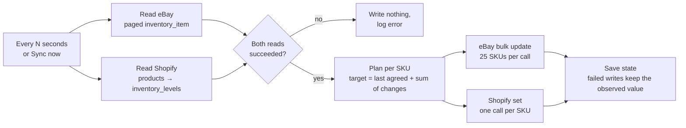

# Marketplace Inventory Sync

A Node.js service that keeps stock levels in step between an eBay store and a Shopify store, and keeps going when either API rate-limits, times out or fails.

A shop that sells the same items on eBay and on its own Shopify store has two stock counts for each item. When a tent sells on eBay, Shopify still shows the old number, and the shop can sell stock it no longer has. A simple "copy eBay to Shopify" job loses sales whenever both channels sell the same item between runs. This service works out **what changed on each channel since the last sync**, applies all of those changes to the last agreed quantity, and writes the result back to both channels. Requests are retried with backoff and `Retry-After`, a failed write is carried over to the next run without counting a sale twice, and every step is logged as structured JSON.

It runs against two included mock APIs, shaped like eBay's Sell Inventory API and Shopify's Admin REST API, that can be set to fail on purpose.


## How it works



**Reconciling.** [src/sync/reconcile.js](src/sync/reconcile.js) is a pure function. For each SKU it keeps the last agreed quantity and what each channel held after the last sync. The new quantity is

```
target = last agreed + (eBay now − eBay last) + (Shopify now − Shopify last)
```

So with 14 tents, 2 sold on eBay and 1 on Shopify, both channels go to 11. Copying one side over the other would give 12 or 13. Restocks and returns count as positive changes. If both channels sold the last units, the target is clamped to 0 and logged as an oversell.

**First sync.** When a SKU has no history, `INITIAL_STRATEGY` decides the starting point: `min` (default, never shows stock that one side says is gone), `ebay` or `shopify`.

**Retries.** [src/http/retry.js](src/http/retry.js) retries network errors, timeouts, 408, 429 and 5xx. It uses exponential backoff with full jitter, capped by `RETRY_MAX_MS`, and waits exactly as long as the `Retry-After` header says when there is one (Shopify sends `Retry-After: 2.0`). Other 4xx errors, such as a bad token, fail on the first try. All writes set an **absolute** quantity (eBay `bulk_update_price_quantity`, Shopify `inventory_levels/set`), never an adjustment, so retrying a write that timed out but actually went through can't apply it twice.

**Partial failures.** eBay's bulk endpoint can accept some SKUs and reject others, and the result is tracked per SKU. When a write fails, the state remembers what that channel still holds, so the next run fixes it without subtracting the same sale again (see the `does not double-count` test). If either channel can't be read at all, the run writes nothing, because syncing from half the data could undo real sales.

**Other edge cases handled:**
- Shopify keeps SKUs on variants and stock on inventory items, so the adapter maps `sku → inventory_item_id` across paginated `products.json` (cursor in the `Link` header) and reads levels 50 at a time.
- A SKU used by two Shopify variants is skipped with a warning, because it can't be matched to one eBay listing.
- A SKU listed on only one channel is reported and not synced.
- Runs never overlap. A "Sync now" during a scheduled run gets that run's result.
- State is written to a temp file and renamed into place, with a retry for Windows file locks. If saving still fails, the state stays in memory so the next run is still correct.

## Structured logging

Logs are JSON lines from [pino](https://getpino.io), one event per line, each tagged with `runId` and, for HTTP calls, `channel`. They can go straight into Loki, CloudWatch or Datadog and be filtered by run or SKU.

```json
{"level":"info","time":"2026-10-29T12:00:20.889Z","service":"inventory-sync","runId":"286a1097","sku":"RO-TENT-2P","base":14,"observed":{"ebay":12,"shopify":13},"deltas":{"ebay":-2,"shopify":-1},"target":11,"writes":["ebay","shopify"],"msg":"quantity change planned"}
{"level":"warn","time":"2026-10-29T12:00:48.250Z","service":"inventory-sync","channel":"shopify","method":"POST","url":"/admin/api/2024-10/inventory_levels/set.json","attempt":1,"nextAttempt":2,"delayMs":230,"status":503,"msg":"retrying request"}
{"level":"info","time":"2026-10-29T12:00:20.942Z","service":"inventory-sync","runId":"286a1097","status":"ok","counts":{"skus":12,"changed":1,"writes":2,"failedWrites":0,"unmatched":2,"oversold":0},"durationMs":219,"msg":"sync finished"}
```

`LOG_LEVEL=debug` also logs every successful HTTP request with its status and duration. Access tokens are sent as headers and never logged. `npm run dev` pipes the same logs through `pino-pretty` for reading in a terminal.

## Tech stack

- Node.js 22 (ES modules, built-in `fetch`, `node:test`), no TypeScript build step
- Express 5 for the service API, dashboard and mock marketplaces
- pino for structured logging
- Plain HTML/CSS/JS dashboard
- Docker Compose: the sync service plus both mocks

## Run it

### Docker

```bash
cp .env.example .env        # optional; the defaults work
docker compose up --build
```

- Dashboard: http://localhost:3000
- Mock eBay API: http://localhost:4001 (`GET /_mock/inventory` shows its stock)
- Mock Shopify API: http://localhost:4002

The mocks keep stock in memory and the service keeps its baseline in `data/state.json`, so restart them together (`docker compose down && docker compose up`) to start over.

### Locally

```bash
npm install
cp .env.example .env
npm run dev                 # mocks + sync + dashboard in one process, pretty logs
```

Or run them separately: `npm run mocks` in one terminal and `npm start` in another.

### Try it

1. Open the dashboard. The first sync has already lowered `RO-TENT-4P`, `RO-STOVE-TI`, `RO-JKT-RAIN-L` and `RO-MUG-450` to the lower of their two counts, and listed the two SKUs that exist on only one channel.
2. Click **Sell 1 on eBay** and **Sell 1 on Shopify** on the same row, then **Sync now**. Both channels drop by 2.
3. Run `npm run simulate` in another terminal to sell a random item every 3 seconds. With the default 5% fault rates, `retrying request` warnings show up in the logs within a minute.
4. Make the APIs fail more often: `curl -X POST localhost:4002/_mock/faults -H "content-type: application/json" -d "{\"failureRate\":0.5}"`.

### Tests

```bash
npm test
```

42 tests, no network access or API keys needed. Most of them run the real HTTP client against both mock APIs on random ports with scripted faults: 429 with and without `Retry-After`, 503s, a request that times out, a rejected token, a channel that stays down, a partly failed bulk update, pagination, and a duplicate SKU.

## API

| Method | Path | Returns |
| --- | --- | --- |
| `GET` | `/` | Dashboard |
| `GET` | `/health` | `{ status: "ok" }` |
| `GET` | `/api/status` | `{ running, lastRun, history[] }`. `lastRun` has per-SKU `observed`, `deltas`, `target`, `writes`, `failed` |
| `POST` | `/api/sync` | Runs a sync now and returns its report (`502` if the run failed) |
| `GET` | `/api/config` | Channels, interval, strategy, dry-run flag |
| `POST` | `/api/demo/sale` | `{ channel, sku, quantity }`, sells on a mock. Only when `DEMO_CONTROLS=true` |

## Configuration

See [.env.example](.env.example).

| Variable | Default | Purpose |
| --- | --- | --- |
| `SYNC_INTERVAL_SECONDS` | `30` | Time between the end of one run and the start of the next. `0` = manual only |
| `INITIAL_STRATEGY` | `min` | First sync of a SKU: `min`, `ebay` or `shopify` |
| `DRY_RUN` | `false` | Plan and log, but write nothing and save no state |
| `STATE_FILE` | `data/state.json` | Last agreed quantities |
| `REQUEST_TIMEOUT_MS` | `5000` | Per attempt |
| `RETRY_MAX_ATTEMPTS` / `RETRY_BASE_MS` / `RETRY_MAX_MS` | `5` / `250` / `8000` | Backoff settings |
| `EBAY_BASE_URL`, `EBAY_TOKEN` | mock | eBay API and OAuth token |
| `SHOPIFY_BASE_URL`, `SHOPIFY_TOKEN`, `SHOPIFY_API_VERSION`, `SHOPIFY_LOCATION_ID` | mock, `2024-10`, `1001` | Shopify Admin API |
| `MOCK_RATE_LIMIT_RATE`, `MOCK_FAILURE_RATE`, `MOCK_LATENCY_MS` | `0` | How often the mocks answer 429 or 503, and their added latency |
| `DEMO_CONTROLS` | `false` | Sell buttons on the dashboard |
| `LOG_LEVEL` | `info` | `debug` logs every HTTP request |

## Project layout

```
src/
  http/retry.js          backoff, Retry-After, what counts as retryable
  http/client.js         fetch wrapper: timeouts, per-attempt logging, retries
  channels/ebay.js       eBay adapter: paged reads, bulk writes with per-SKU results
  channels/shopify.js    Shopify adapter: variant → inventory item mapping, Link pagination
  sync/reconcile.js      pure planning logic
  sync/engine.js         one run: read, plan, write, save, report
  sync/state-store.js    atomic JSON file store
  service.js             Express API, dashboard, scheduler wiring
mocks/                   the two mock marketplaces, fault injection, seed catalog
test/                    node:test suites
```

## Limitations

- **Mock APIs only.** The adapters follow the real endpoint shapes, but a real store needs eBay OAuth (refreshing the user token) and a Shopify custom-app token, and has not been tested against live APIs. Shopify is moving its Admin API to GraphQL. A GraphQL adapter would only replace [src/channels/shopify.js](src/channels/shopify.js).
- **Single Shopify location.** Multi-location stock would need a rule for splitting quantities across locations.
- **Read-then-write race.** A sale that lands between this service reading a channel and writing to it is overwritten. The next run doesn't see it as a change. Shopify's GraphQL `inventorySetQuantities` with `compareQuantity` closes that gap, and webhooks (`inventory_levels/update`, eBay notifications) would shrink the window from the polling interval to seconds.
- **Ambiguous write results.** If a write times out but went through, the state assumes it didn't, and the next run can count that channel's change twice. Re-reading the channel after a timed-out write would remove this case.
- **One process.** State is a JSON file and runs are serialized in memory. Running several replicas would need a shared store (Postgres or Redis) and a lock.

Ridgeline Outfitters, the sample store, is made up.

## sort entries

Updated implementation details.

## compact storage

Updated implementation details.

## sort entries

Updated implementation details.

## invalidate cache

Updated implementation details.

## hash password

Updated implementation details.